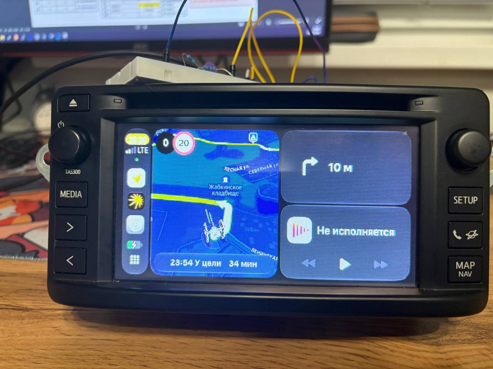
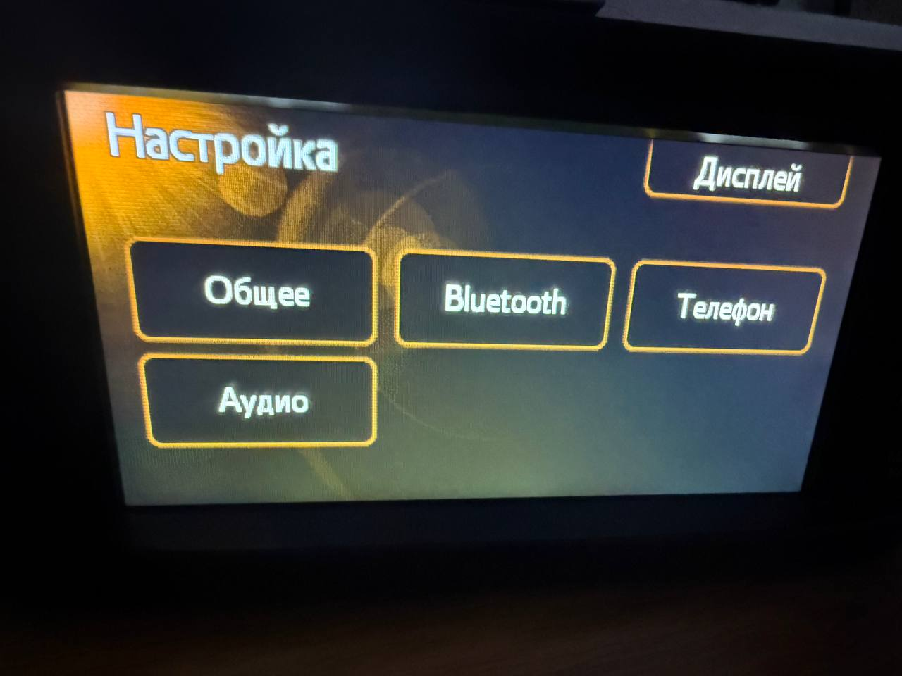

# Toyota Touch 1 · Arduino Nano для внешнего медиаблока

Прошивка для **Arduino Nano Classic, ATmega328P, 5 В / 16 МГц**. На стенде с магнитолой **Toyota Touch TAS300 (PZ473-00213-00)** Nano выступала на шине AVC-LAN как внешний навигационный блок. Она запрашивает внешний экран и передаёт на Linux-приставку по USB события сенсора и кнопок. Приставка рисует интерфейс и возвращает изображение на аналоговый вход RGBHV магнитолы.

При работе с внешним навигационным блоком управление медиа на этой комплектации переходит к нему. Поэтому мы сделали собственный экран мультимедиа. На стенде нажатие MEDIA или «Источник» открывало меню внешнего блока, касание выбирало источник, а Nano передавала соответствующую команду магнитоле. Проверено переключение на AM, FM и CD. Касания в CarPlay получал Linux через мост USB → `uinput`. [Экран и управление медиа](docs/media.md) · [Карты сенсора](docs/touch.md)

| CarPlay на экране TAS300 | Наше меню управления мультимедиа |
|:---:|:---:|
|  |  |

## Подключение и настройка

Перед сборкой сверьте контакты разъёмов магнитолы по [схеме Z18 и Z19](docs/pinout.md).

1. Соберите две ветви приёма и две ветви передачи по [схеме Nano ↔ AVC-LAN](docs/wiring.md). На Z18 подключается шина, на Z19 — видео. На схеме указаны номиналы и положение полосы каждого диода.
2. Настройте внешний источник изображения по [параметрам RGBHV](docs/rgbhv.md). В таблице рядом приведены заводские тайминги 480×240p60 и проверенные на стенде настройки HiSilicon с HDMI→VGA.
3. Подключите Nano по USB к Linux-хосту. Для самостоятельного использования моста и меню см. [запуск на Linux](docs/media.md). Формат событий USB, калибровка и зоны кнопок приведены в [картах касаний](docs/touch.md).

## Проверенный образ Nano

[Готовый Intel HEX](release/toyota-touch-nano.hex) содержит **10 076 байт приложения**. 24 ноября 2026 года все эти байты сверены с flash подключённой стендовой Nano командой проверки AVRDUDE. Образ предназначен для записи через уже установленный загрузчик. Обозначение `178` в имени скетча историческое. Эта версия использует адрес модуля **0x122** и адрес магнитолы **0x120**.

SHA-256 файла HEX: `470b6ad1fbe5e4cc365afdf7859d261764da9b37a7274c46906435ecbc62e966`. [Файл контрольной суммы](release/SHA256SUMS)

На проверенной плате выбран **ATmega328P (Old Bootloader)**. Скорость загрузчика **57 600 бод**, работающей программы **250 000 бод, 8N1**. Ниже команды для AVRDUDE из Arduino AVR Boards. Запускайте из корня репозитория. Замените `COM9` на порт своей Nano (в Linux, например, `/dev/ttyUSB0`). Если AVRDUDE установлен отдельно, укажите его конфигурацию через `-C`.

Сверить уже записанное приложение. Открытие порта штатно сбрасывает Nano.

```shell
avrdude -p m328p -c arduino -P COM9 -b 57600 -n -D -U flash:v:release/toyota-touch-nano.hex:i
```

Записать образ на свою Nano. При успешной записи AVRDUDE также проверяет результат.

```shell
avrdude -p m328p -c arduino -P COM9 -b 57600 -D -U flash:w:release/toyota-touch-nano.hex:i
```

Примерно через 1,66 с после сброса программа автоматически начинает обмен. В последовательном терминале команды завершаются переводом строки. `STOP` останавливает передачу, `GO` запускает её снова, `DSP` запрашивает внешний экран в активном режиме.

## Собрать тот же HEX из исходников

Нужны Python 3 и **Arduino AVR Boards 1.8.8** (AVR GCC `7.3.0-atmel3.6.1-arduino7`). Пакет плат можно установить через менеджер плат Arduino IDE или командой `arduino-cli core install arduino:avr@1.8.8`. Скрипт заново собирает скетч и ядро, затем сравнивает Intel HEX с образом стенда.

Windows, PowerShell:

```powershell
python tools/build.py --arduino-package "$env:LOCALAPPDATA/Arduino15/packages/arduino" --verify
```

Linux с обычным каталогом Arduino CLI:

```sh
python3 tools/build.py --arduino-package ~/.arduino15/packages/arduino --verify
```

Результат записывается в `build/toyota-touch-nano.hex`. На Windows независимая пересборка совпала с проверенным HEX до байта. Для просмотра исходников в Arduino IDE откройте [Tirta_NAVI_178.ino](firmware/Tirta_NAVI_178/Tirta_NAVI_178.ino).

Условия распространения, авторы исходного драйвера и использованные проекты перечислены в [NOTICE](NOTICE.md). Фотографии предоставлены владельцем стенда и показывают работу его экземпляра.
