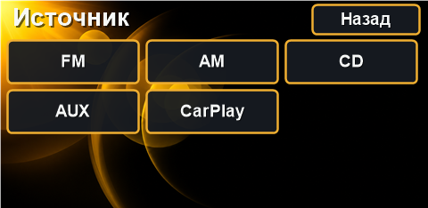

# Экран Media и сенсор по USB

На TAS300 после регистрации внешнего блока магнитола передаёт ему часть управления мультимедиа. Экран рисует Linux на приставке и подаёт изображение на вход RGBHV. Nano принимает события кнопок и сенсора по AVC-LAN и пересылает их на приставку по USB. В обратном направлении Linux отдаёт Nano команды выбора источника и запроса экрана.

Так выглядело меню **«Источник»** на стенде. Его рисовал внешний блок. Код меню и USB-моста находится в каталоге `host/`.



## Как работает «Источник»

1. При нажатии MEDIA в проверенном внешнем режиме или экранной кнопки «Источник» магнитола передаёт событие `B2/85`. Linux открывает меню и отправляет Nano команду `DSP` для показа внешнего видео.
2. Касание подсвечивает кнопку. При отпускании после нажатия на FM, AM, CD или AUX мост посылает Nano одноимённую команду. Эту команду Nano передаёт головному устройству по AVC-LAN. Кнопка «CarPlay» посылает `AUD1`, запрашивая внешний аудиовход. Саму сессию CarPlay устанавливает LIVI.
3. «Назад» закрывает меню. При закрытом меню события сенсора поступают в Linux как устройство **Toyota AVC-LAN Touch**. На стенде владелец управлял CarPlay через сенсор магнитолы. [Кадры, координаты и карта кнопок](touch.md)

На TAS300 подтверждены показ меню, подсветка при касании, повторный вызов и выбор **AM, FM, CD**. Для AUX при той проверке видимой реакции не было. Доступность источника зависит от комплектации ГУ. Подложка в опубликованной версии однотонная. Размер стендового меню **480×234**, положение кнопок и обработка нажатий сохранены. Тайминги физического выхода на магнитолу настраиваются отдельно. [Параметры RGBHV](rgbhv.md)

## Запуск на Linux

Потребуются USB-последовательный порт Nano, Python 3, поддержка `uinput` в ядре и графический сеанс с SDL2. USB–UART на стендовой Nano использовал драйвер `ftdi_sio`. Графический пользователь, запускающий мост, должен иметь доступ на чтение и запись к выбранному последовательному порту и на запись к `/dev/uinput`. Рабочий порт открывает один процесс. Монитор порта Arduino IDE перед запуском следует закрыть.

Из корня проекта на Debian или Ubuntu:

```sh
sudo apt install python3 gcc libsdl2-dev
cd host
cc -O2 -Wall -Wextra source-menu-ui.c -o source-menu-ui -lSDL2
ls -l /dev/serial/by-id /dev/uinput
```

Запустите мост **в графическом сеансе приставки** на том выходе, который подключён к магнитоле. Подставьте порт Nano, найденный выше. Если последовательный порт назначен как `/dev/ttyUSB0`, пример запуска такой:

```sh
python3 -u touch-bridge-phone.py --port /dev/ttyUSB0
```

Мост настраивает Linux-порт на **250000 бод, 8N1**; поставляемая прошивка Nano начинает регистрацию автоматически. При успешном запуске появляется `READY port=...`. При нажатии MEDIA и показе меню в выводе должны появиться `OVERLAY_DISPLAY_REQUEST` и `SOURCE_MENU_UI_READY`. После выбора FM ожидается `SOURCE_SELECTED fm`. При закрытом меню касание и отпускание дают `TOUCH` и `RELEASE`. Полноэкранное приложение использует текущий видеодрайвер SDL. Если на приставке несколько дисплеев, назначьте внешний выход в её композиторе. Для контроля в Linux можно посмотреть события устройства через `evtest`.

Само меню требует только SDL2. При работающем LIVI на том же хосте ключ `--livi-keys` дополнительно подключает обработку кнопок PHONE, переключения треков и событий паузы/воспроизведения. Помощник рассчитан на локальный IPC LIVI с протоколом 11. По умолчанию он ищет `livi/core.sock` в `$XDG_RUNTIME_DIR` пользователя графического сеанса. Другой путь задаётся через `GT86_LIVI_SOCKET`. Для установок с отдельной службой киоска доступна опция `--livi-restart-service ИМЯ_СЛУЖБЫ`: при распознанном на стенде событии перезапуска она вызывает `systemctl restart` этой службы с правами запустившего мост пользователя.

## Проверка без магнитолы

Следующие команды выполняются в `host/`. Последняя запускает меню на виртуальном видеовыходе SDL и подаёт имена кнопок на вход, которым на стенде пользовался мост.

```sh
python3 test_phone_button.py
python3 test_source_menu.py
python3 test_avc_media_keys.py
python3 test_livi_key_bridge.py
printf '%s\n' fm none external none | SDL_VIDEODRIVER=dummy ./source-menu-ui source-menu.bmp
```

Готовая картинка меню `source-menu.bmp` лежит рядом с рендерером. Для смены оформления можно пересобрать её командой `python3 make_menu.py`; для этого нужны Pillow и шрифт DejaVu Sans, либо другой шрифт с кириллицей, переданный через `--font`. [Генератор меню](../host/make_menu.py) · [Рендерер](../host/source-menu-ui.c) · [Мост USB](../host/touch-bridge-phone.py)
