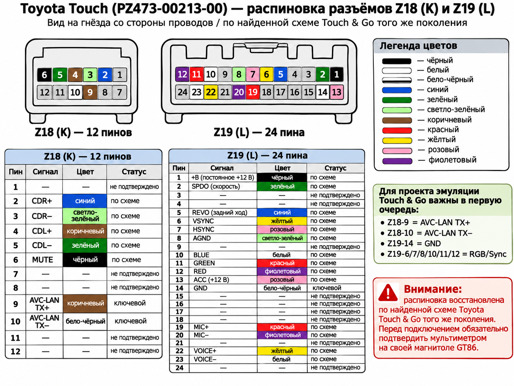

# Распиновка навигационных разъёмов Toyota Touch 1

Распиновка **Toyota Touch TAS300 (PZ473-00213-00)** восстановлена по схеме Touch & Go того же поколения. На рисунке обозначен вид **со стороны проводов**. Перед подключением сверьте ориентацию колодок, номера контактов и питание на своей магнитоле. Контакты, отмеченные на рисунке как неподтверждённые, оставьте свободными.

| Разъём | Контакты для проекта |
|---|---|
| **Z18 (K), 12 контактов** | 9 — AVC-LAN TX+, 10 — AVC-LAN TX− |
| **Z19 (L), 24 контакта** | 6 — VSync, 7 — HSync, 8 — AGND, 10 — B, 11 — G, 12 — R |
| **Z19 (L), питание и масса** | 1 — +B (постоянные +12 В), 13 — ACC (+12 В), 14 — GND |

Контакты +B и ACC нельзя соединять с выводами Arduino или линиями VGA. На схеме **Z19-8** обозначен как возврат видеосигнала AGND, а **Z19-14** — как GND питания.

[Подключение Nano к AVC-LAN](wiring.md) · [Тайминги и подключение RGBHV](rgbhv.md)
